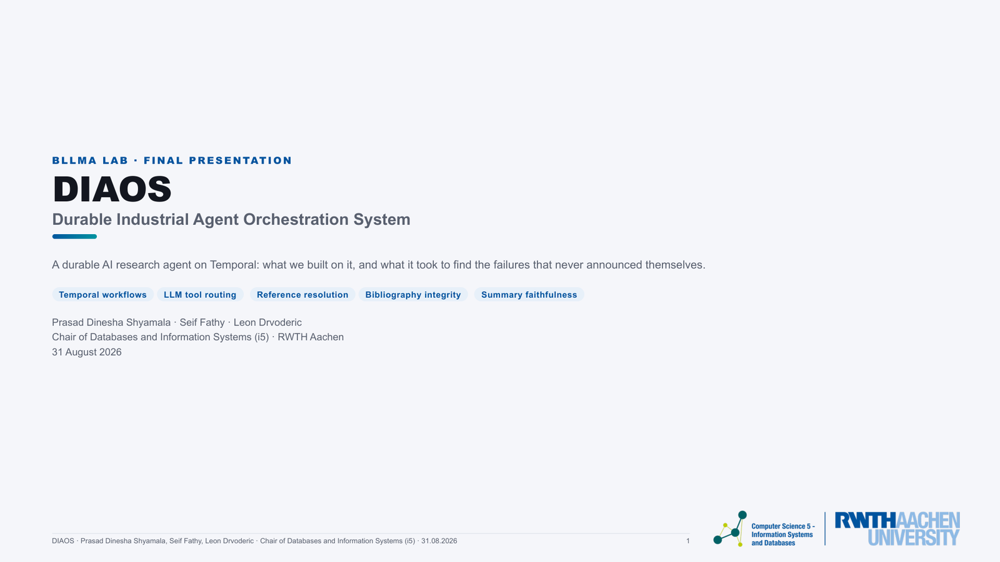
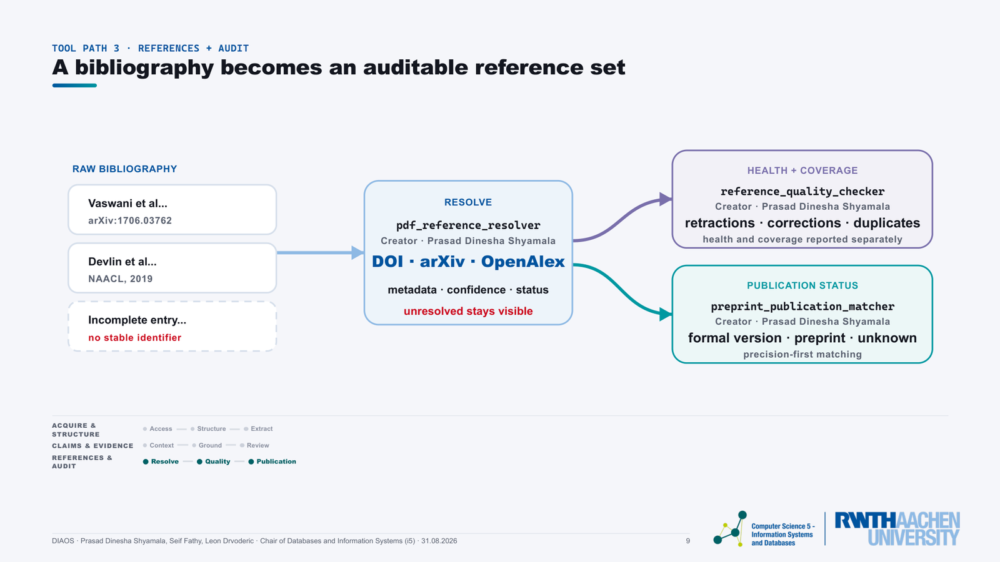
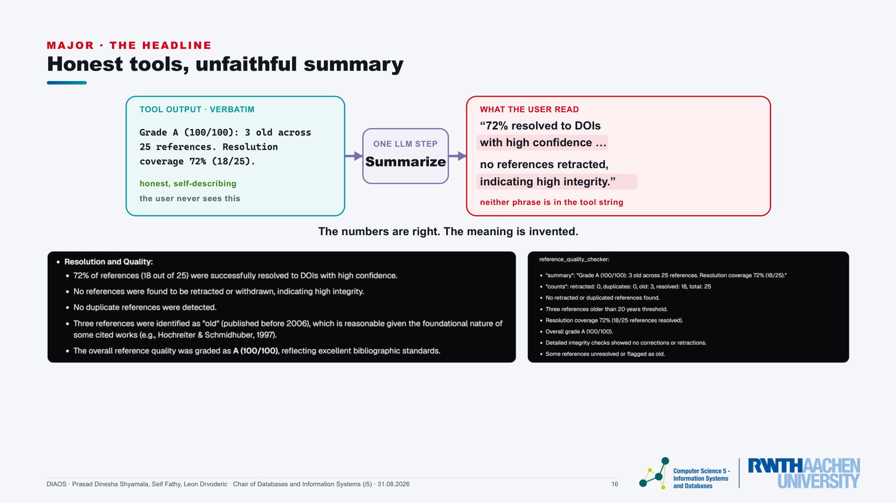

# DIAOS · Final Presentation

**Finding the failures that never crash.** A 41-slide technical talk on a durable AI research agent:
the tools we built on it, and how four silent failures were found, measured, fixed and proven.

BLLMA Lab final presentation · RWTH Aachen University, Chair of Databases and Information Systems (i5) · 31 August 2026

**[▶ View the deck live](https://ds-prasad.github.io/bllma-diaos-final-presentation/DIAOS_Final_Presentation.html)** ·
**[PDF](DIAOS_Final_Presentation.pdf)** ·
**[Demo video (69 s)](DIAOS_Live_Demo.mp4)**

## My role

**Built three research tools** (the bibliography-audit path in Part 1)
- `pdf_reference_resolver`: extracts a paper's bibliography and resolves each entry to a DOI or arXiv id with a
  confidence level, via Crossref, OpenAlex and Semantic Scholar. Unresolved entries stay visible instead of disappearing.
- `reference_quality_checker`: flags retractions, corrections, duplicates and outdated references, and grades
  bibliography health. Resolver coverage is reported separately, so our own blind spots never count against the paper.
- `preprint_publication_matcher`: matches cited arXiv preprints to their peer-reviewed versions.
  12/12 on a hand-verified benchmark, published recall 8/8, zero false "published".

**Fixed two major silent failures**
- **Summarizer hallucination.** The tools reported honestly, but the final summary dropped their caveats, mixed numbers
  across tools and described the planner's intentions as work done. I instrumented the tool-to-LLM boundary, built
  six detectors *before* the fix, then rewrote the summarizer prompt as eight evidence rules
  (one file, +39 −9 lines, no logic changed). Wrong-claim rate **38% → 9%**, unsupported claims **6 → 0**,
  distortion flags **4 → 0**.
- **Retraction detection that found nothing.** The checker read the wrong end of Crossref's retraction relation, so it
  could never flag a cited original. It now reads both relations, plus OpenAlex `is_retracted` as an independent
  second source: 7/7 on a 22-reference benchmark, retraction recall 2/2, zero new test failures.

**Fixed two minor ones**
- **A registered tool the router never chose.** Runtime checks proved the wiring was fine. The cause was planner bias
  plus a hard-coded "search arXiv first" instruction, which I replaced with a deterministic short-circuit. Along the way
  I found that instruction re-ran on every iteration, making normal queries repeat the arXiv search 6–7 times, and
  made it iteration-aware.
- **Nondeterministic results.** Semantic Scholar rate limits were silently read as "no evidence". I added retries
  that honour `Retry-After` and an arXiv-based rescue chain, and verified the fix live during an outage.

I also designed and built this deck end to end, and presented incidents ① and ② in the talk.

Team project with **Seif Fathy** and **Leon Drvoderic**: they built the other six Part 1 tools, and each slide
credits the tool's creator. Seif presented the Part 2 opening and incident ③.

## What it covers

DIAOS (Durable Industrial Agent Orchestration System) is an AI research agent built on Temporal workflows.
An LLM plans the research request, then routes it to tools over several iterations and summarizes the results.
Every step is recorded, retryable and inspectable.

- **Part 1 · Tools implemented.** Nine research tools were added to the 12-tool baseline, in three paths:
  acquire and structure papers, connect claims to evidence, and audit bibliographies. The part ends with a recorded end-to-end run.
- **Part 2 · Bottlenecks, blockers & fixes.** Four incidents, and not one of them produced a crash, an exception or a red test.
  Each is walked through as *observe → isolate → measure → fix → prove*.
- **Appendix.** Known issues, the detector catalogue, a gallery of real captures, and how every number was derived.

  
  

## Viewing

Open the [live deck](https://ds-prasad.github.io/bllma-diaos-final-presentation/DIAOS_Final_Presentation.html).
For an offline copy, download `DIAOS_Final_Presentation.html` together with `figures/` and open it in any modern browser.

| Key | Action |
| --- | --- |
| `→` `Space` / `←` | Next / previous slide |
| `Home` / `End` | First / last slide |
| `F` | Fullscreen present mode (`Esc` to leave) |
| `N` | Speaker notes |

To open a specific slide, add `#s16` to the URL. Add `#s16,present` to open that slide fullscreen.

## Contents

| Path | What it is |
| --- | --- |
| `DIAOS_Final_Presentation.html` | The deck: 41 slides, 16:9, one self-contained file |
| `DIAOS_Final_Presentation.pdf` | PDF export with selectable text, one slide per page |
| `DIAOS_Live_Demo.mp4` | Recorded end-to-end run on *Attention Is All You Need* (69 s, 1280×720) |
| `figures/` | Slide media: `S01-` tools, `S02-` incident screenshots, `S03-` appendix captures |
| `preview/` | Slide renders used in this README |
